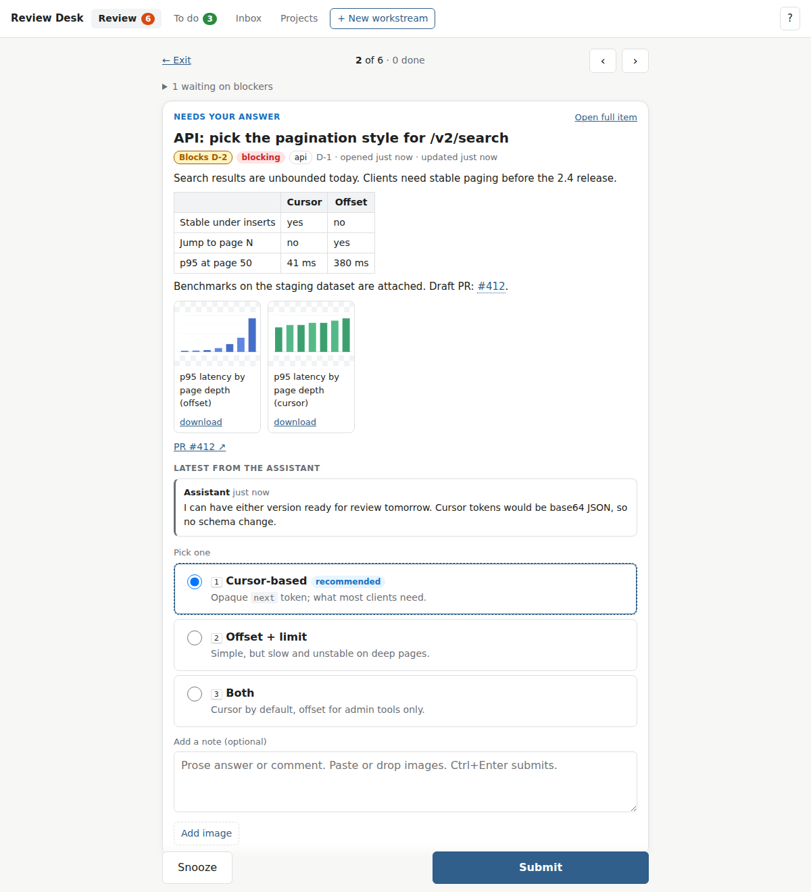
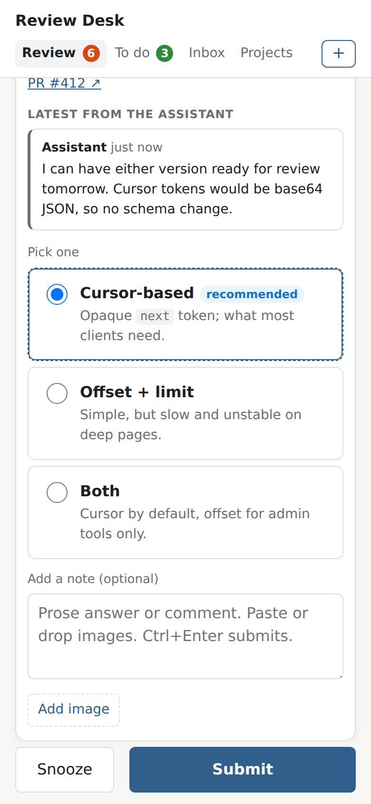
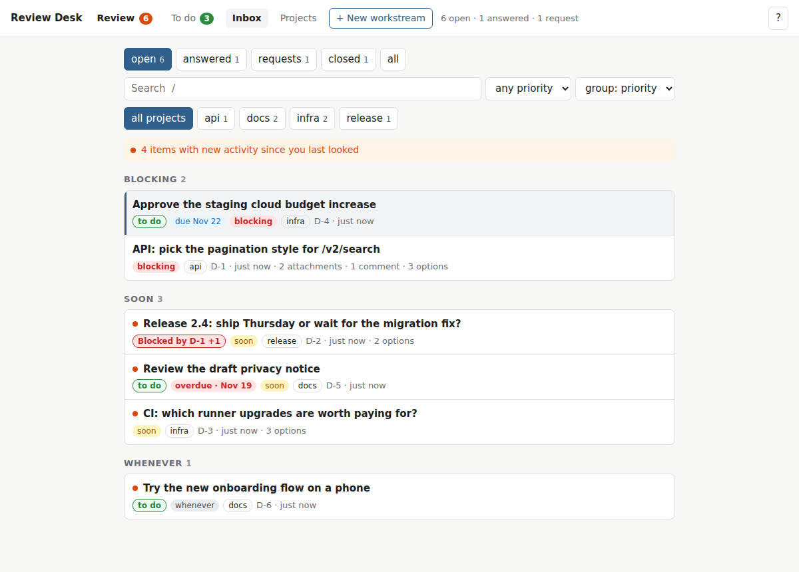
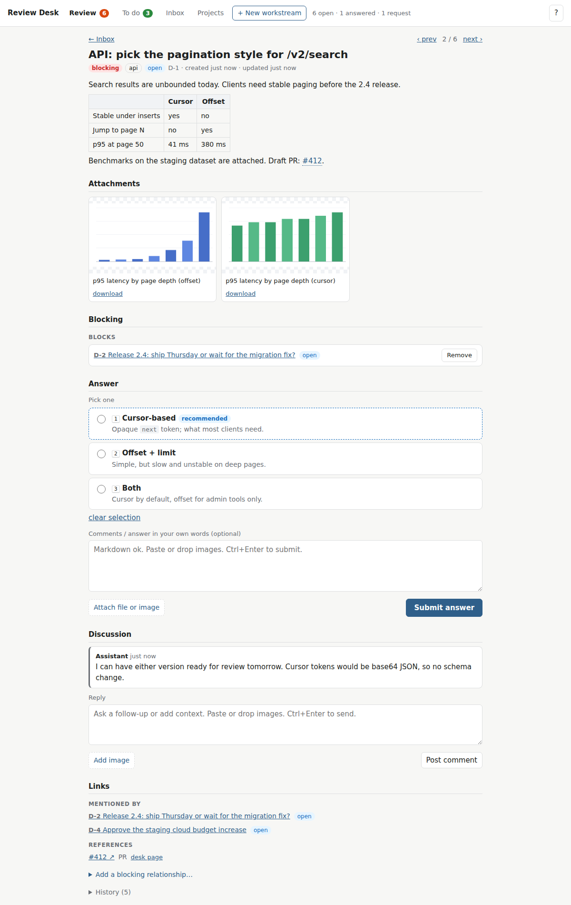
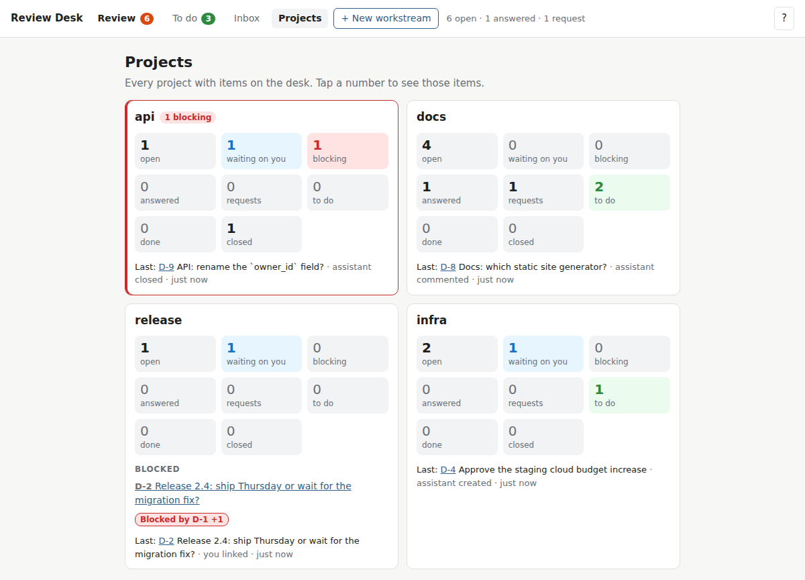

# Review Desk

A human-in-the-loop decision desk for AI agents.

Agents that run for hours keep hitting questions only a person can answer: which
design to pick, whether to merge, whether something is worth paying for. Review
Desk gives those questions one place to land. Agents post **one decision per
item**, with **multiple-choice options and a recommended one**, attachments and
links. The owner works through them in a browser, on a desktop or a phone,
by picking an option, writing a prose reply, or both. Agents poll for the
answers with one CLI call and act on them.

It is a single Python file plus a static UI: Python 3.10+, **standard library
only** (`http.server` + `sqlite3`), no build step, no dependencies. It is not tied
to an agent framework. Anything that can run a shell command or make an HTTP
request can use it.



<p>


</p>

## Features

- **Decision items**: a title, a Markdown body, and options (single or
  multi-select) with one or more marked *recommended*. The owner picks options,
  writes a prose answer, or both, and can attach files.
- **Review queue**: one card at a time over everything that needs the owner.
  Swipe right (or press Enter) to submit; with nothing picked, a swipe right
  approves the recommended option after a 3-second undo window. Swipe left (or
  `s`) to snooze an item to the back of the queue. Every submit can be undone
  for a few seconds. Answered items leave the queue.
- **Owner TODOs**: when the owner has to *do* something (sign in somewhere,
  approve a budget, test on a device), agents file a TODO with an optional due
  date. TODOs appear as a checklist and as queue cards.
- **Workstream requests**: the owner can open a request ("+ New workstream") for
  the agents; an agent claims it and reports progress in its thread.
- **Projects**: every item belongs to a project; `/projects` shows a rollup per
  project.
- **Blocking links**: "D-2 is blocked by D-1". Blocked items wait outside the queue
  until their blockers are finished. Cycles are refused.
- **References**: `D-12` links to a desk item. If configured, `#123` links to a
  pull request, `ABC-45` to your issue tracker, and short commit hashes to commits.
  Every item lists its backlinks ("Mentioned by").
- **Attachments**: images, Markdown, text, HTML (previewed in a sandboxed
  iframe), PDFs and links. You can paste or drop images straight into any reply
  box.
- **Image viewer**: arrow keys, swipe, zoom and pan with a trackpad, mouse wheel,
  pinch or keys, and deep links to a single image.
- **Agent polling**: `rd changes --since T` returns every answer, comment, TODO
  completion, new request and status change since `T`, as JSON.

<p>


</p>

## Quick start

```bash
git clone <this repo> reviewdesk && cd reviewdesk
./start.sh                       # or: python3 server.py   (http://127.0.0.1:8471/)
./rd new --title "Pick a name for the CLI" --project tooling \
    --option "rd|short, already in the docs|recommended" \
    --option "review-desk|explicit, longer to type"
# created #1 (D-1)  http://127.0.0.1:8471/item/1
```

Open <http://127.0.0.1:8471/>, press `q` for the review queue, and answer. Then:

```bash
./rd changes --since 2026-01-01T00:00:00Z
```

To explore with sample data, start a desk on an empty data directory and run
`scripts/seed_demo.py`:

```bash
RD_DATA_DIR=/tmp/rd-demo RD_PORT=8480 ./start.sh
RD_URL=http://127.0.0.1:8480 scripts/seed_demo.py
```

`./stop.sh` stops a server started by `start.sh`. Use the same `RD_DATA_DIR`
you started it with.

## The agent workflow

Give each agent the `rd` CLI (set `RD_URL` if the desk is not on
`http://127.0.0.1:8471`) and a loop like this:

1. **Ask.** When a decision needs the owner, file *one decision per item*. Give it
   the context needed to decide without reading anything else, two to four options
   with the one you would pick marked `recommended`, and a project. If the owner
   has to *do* something, use `rd todo` instead.
2. **Poll.** Run `rd changes --since <T>` on a schedule. The first time, use the
   time the agent started. After that, use the `now` value from the previous result.
   The window is `(since, now]`, so nothing is missed or repeated.
3. **Act.** For each answer, comment, finished TODO and new request, run
   `rd show <id>` for the full context and do the work.
4. **Report and close.** Post what you did with `rd comment <id>`, then
   `rd close <id> --comment "Done in #412"`.
5. **Follow up.** If an answer raises a question, `rd reopen <id> --comment "..."`
   puts the item back in the owner's queue. Don't open a new item for it.

Answered items leave the owner's queue on their own. They come back only when an
agent reopens them or posts new activity.

A paragraph like this works well in an agent's instructions:

> When you need a decision from the owner, run `rd new` with one question, a
> self-contained body, 2–4 `--option`s with your pick marked `recommended`, and
> `--project`. When the owner must do something themselves, run `rd todo`. Poll
> `rd changes --since <last now>` between tasks. Act on every answer, comment, done
> TODO and request in it, report with `rd comment`, and `rd close` items when
> finished. Write `D-<n>` to refer to desk items.

## CLI reference: `rd`

`rd` is a single-file Python CLI (stdlib only) that talks to the server at
`$RD_URL` (default `http://127.0.0.1:8471`). Every `<id>` accepts `76`, `D-76` or
`D76`.

```bash
rd new --title "..." [--body "..." | --body-file f.md | --body-file -] \
       [--project NAME] [--priority blocking|soon|whenever] \
       [--option "label|description|recommended"]... [--multi] \
       [--blocks N]... [--blocked-by N]... [--attach PATH|URL]... [--json]
rd todo --title "..." [--body ...] [--project NAME] [--priority ...] [--due YYYY-MM-DD] \
        [--blocks N]... [--blocked-by N]... [--attach PATH|URL]...
rd update <id> [--title ..] [--body ..|--body-file ..] [--project ..] [--priority ..]
               [--status open|answered|closed|requested|in_progress|done] [--due YYYY-MM-DD|none]
               [--option ...]... [--clear-options] [--multi yes|no]
rd show <id> [--json]                  # body, options, attachments (with local paths), answers, thread
rd list [--status open|answered|closed|requested|in_progress|requests|active|all|a,b]
        [--since ISO] [--project NAME] [--kind decision|workstream|todo] [--json]
rd changes --since ISO                 # JSON, see below
rd comment <id> --body "..."           # or --body-file f.md / -
rd attach <id> PATH|URL [--label "..."]
rd close <id> [--comment "..."]
rd reopen <id> [--comment "..."]       # follow-up: back into the owner's queue
rd done <id> [--comment "..."]         # mark a TODO done (e.g. you verified it happened)
rd convert <id> --kind todo|decision [--title ..] [--status ..] [--due ..]
rd claim <id> --note "plan, branch, ETA"   # owner's workstream request -> in_progress
rd link A blocks B | rd link A blocked-by B | rd unlink A blocks B
rd projects [--json]                   # per-project rollup
rd ref pr 123 | rd ref commit 3bed51b | rd ref issue ABC-45   # desk items that mention it
rd delete <id>                         # permanent, removes its files
```

- `--option` is `label|description|recommended`. The description and the third
  field are optional; `recommended`, `rec`, `yes`, `1` or `*` mark an option as
  recommended. Option keys are `o1`, `o2`, ... in order.
- Priorities: `blocking`, `soon` (the default), `whenever`. Project names match
  `[a-z0-9][a-z0-9_-]*` (32 characters at most); the default is `general`.
- Bodies, option descriptions, comments and answers are Markdown: headings, lists,
  tables, code, links and task lists. Raw HTML is escaped, never rendered.

### `rd changes`

```json
{"since": "...", "now": "2026-01-18T06:40:00.123456Z",
 "answers":  [{"item_id": 3, "item_title": "...", "choices": ["o1"], "choice_labels": ["Cursor-based"],
               "text": "...", "attachments": [], "created": "..."}],
 "comments": [{"id": 140, "item_id": 3, "author": "owner", "body": "...", "created": "...",
               "attachments": [{"id": 121, "filename": "pasted-20260120-091930-1.png",
                                "content_type": "image/png", "href": "/files/121/pasted-....png",
                                "path": "/path/to/data/files/3/<uuid>_pasted-....png"}]}],
 "events":   [{"item_id": 3, "kind": "reopened", "detail": "closed -> open", "item_kind": "decision"}],
 "requests": [{"id": 9, "title": "Docs: write the upgrade guide", "project": "docs", "body": "...",
               "priority": "soon", "status": "requested", "blocks": [2], "blocked_by": [],
               "attachments": []}],
 "todos_done": [{"id": 4, "title": "...", "project": "infra", "done_at": "...", "note": "..."}]}
```

- `answers`: the owner's answers. `choice_labels` are the picked options' labels.
- `comments`: the owner's comments. Agents' own comments are left out. Files the
  owner pasted or dropped are listed with an `href` (fetch it from the desk) and a
  `path` (read it directly when the agent runs on the same machine).
- `events`: other owner actions, such as `reopened`, `closed` (a withdrawn request),
  `linked`/`unlinked`, and `retracted` (the owner used Undo on an answer or comment;
  check the item again if you already acted on it).
- `requests`: new workstreams the owner opened. Read one with `rd show`, take it
  with `rd claim <id> --note "plan"`, report with `rd comment`, and finish with
  `rd close`.
- `todos_done`: TODOs the owner completed. `note` is any text they sent with it.

## Concepts

**Item kinds and statuses**

| Kind | Written by | Statuses |
|---|---|---|
| `decision` | agent | `open` → (owner answers) `answered` → (agent `rd close`) `closed` |
| `todo` | agent | `open` → (owner ticks it, or `rd done`) `done`; `rd close` = no longer needed |
| `workstream` | owner | `requested` → (agent `rd claim`) `in_progress` → `closed` |

The owner can reopen any item. Answering again adds a new answer; the history is
kept and the latest answer is current. Comments never change status.

**The review queue** (`/queue`, `GET /api/queue`) holds every unfinished item that
needs the owner:

- an open decision with no owner answer since the agent last acted on it,
- an item where the agent did something since the owner last looked,
- a workstream request with an agent reply the owner hasn't seen (the claim note
  doesn't count),
- an open TODO,
- an item the owner snoozed.

A decision the owner has answered stays out of the queue while the agent works on
it. Items whose blockers are not finished are listed as "waiting" instead.
The queue is ordered by priority, then due date, then age, with snoozed items last.

**Blocking.** `rd link A blocks B` makes a manual edge. An item with a blocker
that is not `closed` or `done` shows "Blocked by D-x" and waits outside the queue.
Mentions (`D-12` in any text) become backlinks automatically.

## The owner UI

- **Review (N)** (`q`): the card queue described above. Keys: `1`–`9` pick
  options, `Enter` submits, `Ctrl/Cmd+Enter` submits while you type, `s` snoozes,
  `u` undoes, `←`/`→` move between cards without answering, `Esc` leaves.
- **To do (N)** (`Shift+T`): the owner's checklist, grouped by project. Tap the
  circle to complete an item; Undo is available for 5 seconds.
- **Inbox**: status tabs, project chips, a priority filter, search (`D-76` works
  too), grouped by priority or project. Keys: `j`/`k`, `Enter`, `/`.
- **Projects** (`Shift+P`): one card per project with counts that link into the
  filtered inbox, plus its blocked items and latest activity.
- **New workstream** (`Shift+N`): title, project, priority, a Markdown
  description with preview, blocking links and attachments. Drafts survive a
  reload.
- **Item page**: the rendered body, attachments, an option picker, a free-text
  answer, the discussion, blocking links, backlinks and history.
- **Image viewer**: click any image. Use `←`/`→`, `+`/`-`, `0` to fit, `1` for
  100 %, drag to pan and pinch to zoom; double-click switches between fit and
  100 %.
- **Pasting images**: in any reply, answer or description box, `Ctrl/Cmd+V` or
  drag and drop adds an image. It uploads with the message (at most 20 files and
  25 MB per message).

Press `?` in the UI for every shortcut.

## Configuration

| Setting | Default | Meaning |
|---|---|---|
| `--host` / `RD_HOST` | `127.0.0.1` | Bind address. |
| `--port` / `RD_PORT` | `8471` | Port. |
| `--data-dir` / `RD_DATA_DIR` | `./data` next to `server.py` | SQLite database, uploaded files, backups and logs. |
| `RD_URL` | `http://127.0.0.1:8471` | Where `rd` (and the example scripts) find the server. |
| `RD_PR_URL_BASE` | unset | e.g. `https://github.com/org/repo/pull/`. Turns `#123` and `PR #123` into links to `<base>123`. When the base is a GitHub repo, `org/repo#123` and that repo's PR and issue URLs are recognised too. Unset: `#123` stays plain text. |
| `RD_GIT_DIR` | unset | A local clone. Hex tokens of 7 to 40 characters that `git rev-parse` resolves in it become commit references. Unset: commits are not detected. |
| `RD_COMMIT_URL_BASE` | derived | e.g. `https://git.example.com/org/repo/commit/`. Derived automatically from a GitHub `RD_PR_URL_BASE`. Without it, commits link to their page on the desk. |
| `RD_ISSUE_PREFIXES` | unset | Comma-separated issue keys, e.g. `ABC,OPS`. Turns `ABC-45` into an issue reference. |
| `RD_ISSUE_URL` | unset | Issue URL template, e.g. `https://tracker.example.com/browse/{id}` (Jira-style) or `https://linear.app/acme/issue/{id}`. Without a template, issues link to their page on the desk. |

`start.sh` reads the same variables. It writes `server.log` and `server.pid` into
the data directory.

### References

Every text an agent or the owner saves (titles, bodies, options, comments,
answers, link attachments) is scanned for references:

| Write | Means |
|---|---|
| `D-76` (also `D76`, `desk #76`, `item #76`) | desk item 76, always |
| `#123`, `PR #123`, `org/repo#123`, a PR URL | pull request 123 (needs `RD_PR_URL_BASE`) |
| `ABC-45`, an issue URL | an issue (needs `RD_ISSUE_PREFIXES`) |
| `3bed51b28` | a commit, if `RD_GIT_DIR` resolves it |

Text inside `code` spans and fenced blocks is never linked. Each item page lists
**Mentioned by** (other desk items that mention it) and **References**, each with
the other items that mention the same reference ("also on D-x"). `/ref/pr/123`,
`/ref/commit/<sha>` and `/ref/issue/ABC-45` list every desk item that mentions
that reference.

## HTTP API

Everything the UI and `rd` do goes through a small JSON API. All endpoints are
unauthenticated (see [Security](#security)).

| Method | Path | Notes |
|---|---|---|
| GET | `/healthz` | `{ok, now}` |
| GET | `/api/items?status=&project=&kind=&priority=&since=` | list, with status counts and project names; `status` takes a comma list or `requests`/`active`/`all` |
| POST | `/api/items` | create `{title, body, project, priority, kind: decision\|todo, due, options: [{label, description, recommended}], multi, blocks: [ids], blocked_by: [ids]}` |
| GET | `/api/items/<id>` | full item: attachments, answers, comments, events, `blocks`, `blocked_by`, `mentions`, `mentioned_by`, `open_blockers`, `xrefs`; `?view=owner` marks it seen |
| PATCH | `/api/items/<id>` | update fields (also `POST /api/items/<id>/update`) |
| DELETE | `/api/items/<id>` | delete, including its files |
| POST | `/api/items/<id>/attachments` | JSON `{url, label}` adds a link; a raw body with `?filename=&label=`, or multipart `file`, uploads a file (25 MB max) |
| POST | `/api/items/<id>/comments` | `{body, author: assistant\|owner}`, or multipart with `file` parts |
| POST | `/api/items/<id>/answer` | owner: `{choices: [keys], text}`, or multipart `choice`*, `text`, `file`* |
| POST | `/api/items/<id>/close` · `/reopen` · `/done` · `/claim` | optional `{comment}`; `?author=owner\|assistant` |
| POST | `/api/items/<id>/convert` | `{kind: todo\|decision, title?, status?, due?}`; keeps answers and comments |
| POST | `/api/items/<id>/snooze` | `{}` snoozes; `{"snoozed_at": null}` clears it |
| POST | `/api/answers/<id>/retract` · `/api/comments/<id>/retract` | owner undo within 10 minutes |
| POST | `/api/requests` | owner opens a workstream (JSON or multipart with files) |
| POST | `/api/links` | `{src, dst, kind: blocks\|blocked_by}` |
| DELETE | `/api/links/<a>/blocks/<b>` | remove a blocking link |
| GET | `/api/changes?since=ISO` | what `rd changes` prints |
| GET | `/api/queue?project=&count=1` | the review queue: `{items, waiting, count}` |
| GET | `/api/todos?project=` | `{open, done, count}` |
| GET | `/api/projects` | per-project rollup |
| GET | `/api/refs/<pr\|commit\|issue>/<key>` | desk items that mention a reference, plus its URL |
| GET | `/api/config` | the reference settings the UI uses |
| GET | `/files/<att-id>/<name>` | an uploaded file; `?mode=raw` returns Markdown or text as `text/plain`, `?mode=sandbox` serves HTML for the sandboxed iframe |

Comments, attachments, links, `close` and `update` act as the agent
(`assistant`) unless the request says `author=owner`, which the UI does. `answer`
is always the owner. `reopen` and `done` act as the owner unless
`?author=assistant` is passed, which `rd` does.

## Security

- **There is no authentication.** Anyone who can reach the port can read every
  item and answer as the owner. The server binds `127.0.0.1` by default and prints
  a warning if you bind anything else. To use it from another device, put it
  behind something that authenticates: an SSH tunnel, a VPN or private overlay
  network, or a reverse proxy with auth and TLS. `examples/tcpfwd.py` forwards
  one private interface address to the localhost-only desk.
- **Uploads are sanitised.** Filenames are reduced to `[A-Za-z0-9._-]` and stored
  under a random prefix. The content type comes from a server-side extension
  table, never from the client. Images are served inline; everything else is sent
  as an attachment. Every file response carries
  `Content-Security-Policy: sandbox` and `nosniff`, so an uploaded SVG or HTML
  file cannot run script in the app's origin. HTML previews use
  `<iframe sandbox="">`.
- **The UI has a strict CSP** (`script-src 'self'`, no inline script). Markdown
  is rendered by a small escaping renderer, raw HTML is never rendered, and links
  are limited to `http(s)`, `mailto` and relative URLs. Link attachments must be
  `http(s)`.
- `rd changes` and `rd show` include each file's local `path`, which is meant for
  agents on the same machine. Keep the data directory private.

## Data, schema and backups

- The data lives in `<data-dir>/reviewdesk.db` (SQLite, WAL mode) and
  `<data-dir>/files/<item>/<uuid>_<name>`.
- `PRAGMA user_version` tracks the schema version. When the server starts on an
  older database, it first copies the data directory to
  `<data-dir>/backup-<UTC timestamp>/` (a consistent SQLite snapshot plus the
  files), then migrates.
- Converting an item between decision and TODO is logged to
  `<data-dir>/conversions-<date>.log`.
- To back up a running desk, use `sqlite3 reviewdesk.db ".backup copy.db"` and
  copy `files/`.

## Tests

```bash
python3 tests/smoke_test.py
```

The smoke test starts its own server on a free port with a temporary data
directory, so it never touches your desk. It runs about 110 end-to-end checks
through `rd` and the HTTP API: uploads and file headers, answers and comments,
`rd changes`, reference linking (with and without configuration), blocking and
cycles, workstream requests, the review queue (order, snooze, undo) and TODOs. It
needs only Python. Commit references are tested when `git` is installed. CI runs
it on Python 3.10 to 3.13 (`.github/workflows/test.yml`).

Optional browser tests (Playwright) cover the review queue, the TODO checklist,
the image viewer and image pasting, on desktop and phone viewports:

```bash
cd tests/browser
npm install && npx playwright-core install chromium   # or set CHROMIUM_PATH
node run.js                                           # starts a throwaway server
node screenshots.js                                   # re-renders docs/screenshots from seed_demo.py
```

## Examples

- `examples/followup_check.py`: a follow-through checker for an orchestrator. It
  flags approved PRs that never got merged, a merge queue whose runner has died,
  items whose blockers have all finished, and agents whose status file has gone
  stale. Each integration point (GitHub API token, merge-queue file, agent status
  files) is an environment variable; leave one unset and that check is skipped.
- `examples/tcpfwd.py`: forwards one private interface address to the
  localhost-only desk.
- `scripts/seed_demo.py`: fills an empty desk with example items.

## Layout

```
server.py           the server: HTTP API, SQLite storage, static file serving
rd                  the agent CLI
static/             the UI: index.html, app.js, app.css, md.js (Markdown + references), viewer.js
start.sh, stop.sh   run the server in the background
scripts/            seed_demo.py
examples/           followup_check.py, tcpfwd.py
tests/              smoke_test.py; browser/ (optional Playwright tests + screenshots)
```

## License

MIT. Copyright (c) 2026 Kevin Balke. See [LICENSE](LICENSE).
